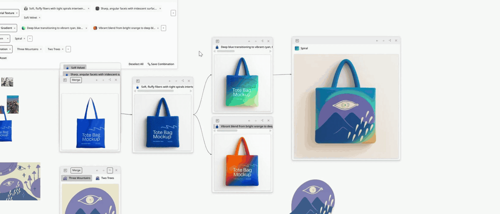
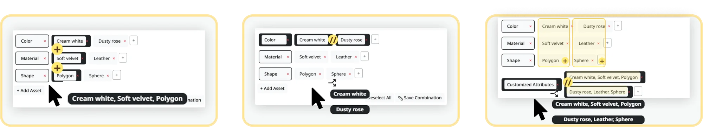
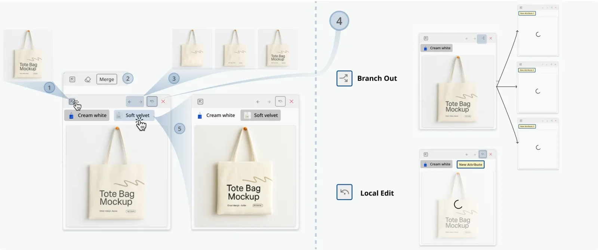
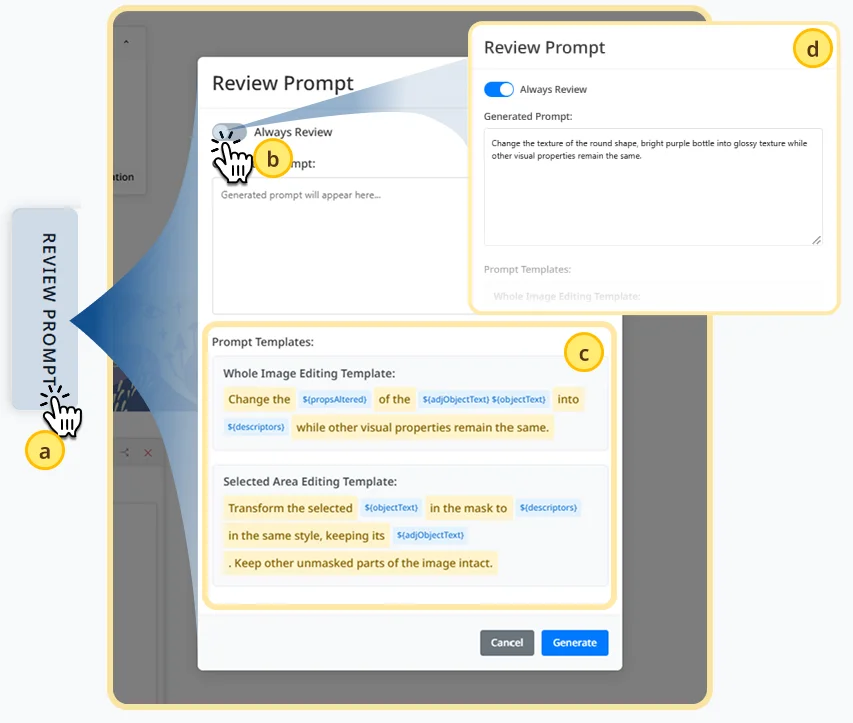
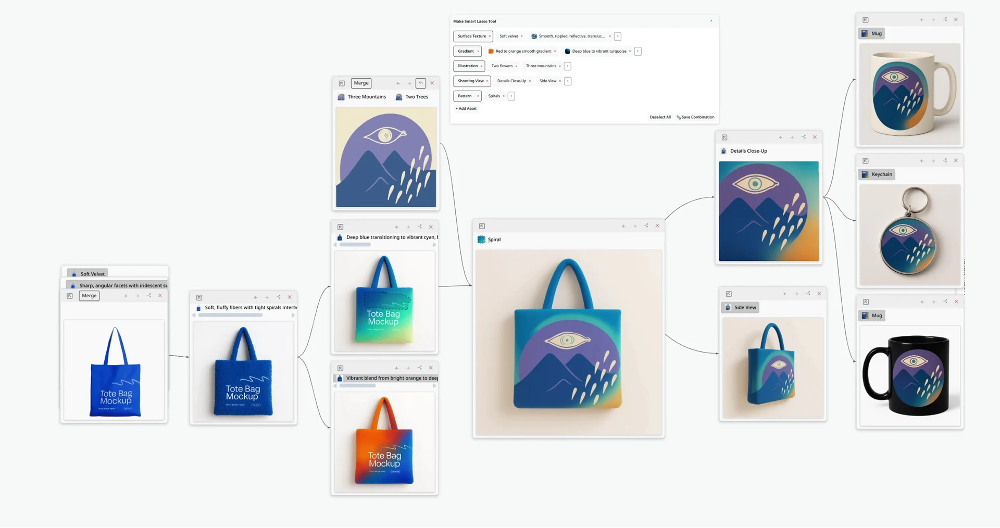

# DesignTrace

**Exploring, Iterating and Tracking Design Alternatives with GenAI** · CHI '26

Xiaohan Peng, Debanjana Haldar, Wendy E. Mackay, Janin Koch

[Paper](https://doi.org/10.1145/3772318.3791036) · [Video](https://www.youtube.com/watch?v=3lxWq0wPxKc) · [Citation](#citation)

<p align="center">
  <a href="https://www.youtube.com/watch?v=3lxWq0wPxKc">
    
  </a>
  <br>
  <sub>Click the animation to watch the full video demo.</sub>
</p>

DesignTrace is a infinite canvas AI design tool for exploring design alternatives, refining them, and tracking how a design evolves. Think of it as _object-oriented version control for iterative creative practice_: each design state is an object you can see, edit, branch from and return to.

## Why

With Generative AI, alternatives can become less explicitly purposeful, as variations emerge from the generative process itself. And creative history is still hard to use:

- _Undo and redo_ form a linear chain of actions. They reach recent states, but say little about what those states looked like.
- _Git-style version control_ saves versions one after another. Creative work is non-linear: what if you want to restart from the middle of a commit?
- _Freeform canvases_ version by copy and paste, so versions scatter, the canvas clutters, and progress gets lost.

DesignTrace asks: _how do we design iteratively with generative content in a way that is explorable and traceable across temporal and spatial scales?_

DesignTrace treats design rationale as two connected kinds of artifacts. **Semantic artifacts** are attributes you extract, create and compose. **Visual artifacts** are images you edit. Each can be turned into the other, and your process is traced at three scales: command history, artifact state and exploration paths.

## How it works

**Palette**: a palette of semantics. Collect attributes into categories by typing them, picking suggested tags, or extracting them from images. Then apply them with the semantic lasso to a whole image or a region: _cumulatively_ to build one alternative with several features, or _in parallel_ to branch into several alternatives at once.

<details>
<summary>Using the Palette</summary>

- **Add**: click _+ Add Asset_ for a new category, then _+_ or a suggested tag for attributes. Drag an image onto a category name to extract attributes from it.
- **Parallel**: single-click a **category name** to select all its attributes. Each one makes its own new Node.
- **Cumulative**: single-click **individual attributes** (across categories). They are combined into one new Node.
- **Apply**: draw a lasso on a Node to change a region, or hover it and click _Apply to the whole image_.
- **Save Combination** keeps the current selection for reuse. Double-click anything to rename it.

<p align="center">
  
  <br>
  <sub>Left to right: cumulative selection, parallel selection, and saved combinations.</sub>
</p>

</details>

**Node**: Each Node has its own canvas and a local history of generation and editing (← and →), so it records the past while still leading to the future. Branch new Nodes from any earlier one, compare alternatives side by side, and use _Save Step_ to collapse the ones you don't need.

<p align="center">
  
</p>

<details>
<summary>Using Nodes</summary>

- **Add**: click _+_ in the bottom toolbar. Drag a Node by its header, and connect Nodes by dragging from the dot on one's right edge to another's left edge.
- **History**: use ← and → to step through a Node's edits, or click a label under the header to jump to that generation.
- **Branch or edit in place**: the mode button in the header switches between branching into new Nodes and editing this Node in place.
- **Edit**: in lasso mode, erase a region, or _Merge_ objects you've moved onto the Node. _Export_ copies the Node's image to the canvas.
- **Tidy up**: select Nodes and click _Save Step_ to collapse the rest into their parent. Drag a collapsed label back out to restore it.

</details>

**Template**: prompt slots that work like variables, filled in from the Palette. It stays minimal: open _Review Prompt_ only when you want to check or edit the prompt.

<details>
<summary>Using the Template</summary>

- **Open**: click the _Review Prompt_ tab on the right edge of the window.
- **Edit**: change the fixed text in the two templates (whole image and selected area). The `${...}` slots are filled in automatically from the attributes and the image.
- **Always Review**: turn it on to check and edit the prompt before every generation.

<p align="center">
  
</p>

</details>

## Getting started

### Requirements

- Node.js 18 or later
- Python 3.10 (the steps below use conda)
- An OpenAI API key

### 1. Backend

```bash
conda create -n DesignTrace python=3.10 -y
conda activate DesignTrace
pip install -r requirements.txt
```

Create a `.env` file in the project root:

```
OPENAI_API_KEY=your-key-here
```

Start the server (it runs on port `10000` by default; set `PORT` to change it):

```bash
python app.py
```

> The first background removal downloads the U²-Net model, so it takes longer than later ones.

### 2. Frontend (development)

In a second terminal:

```bash
cd client
npm install
npm run dev
```

Open the URL that Vite prints (usually http://localhost:5173). In development the frontend calls the backend at `http://127.0.0.1:10000`; to use another address, set `VITE_BACKEND_URL` in `client/.env`.

### 3. Production build

```bash
cd client
npm run build
```

Flask serves the built files from `client/dist`, so after running `python app.py` the whole app is available at http://127.0.0.1:10000.

## Frontend Scripts (in `client/`)

| Command          | What it does                |
| ---------------- | --------------------------- |
| `npm run dev`    | Start the dev server        |
| `npm run build`  | Build for production        |
| `npm run lint`   | Lint and fix with ESLint    |
| `npm run format` | Format `src/` with Prettier |

## Citation

```bibtex
@inproceedings{peng2026:designtrace,
author = {Peng, Xiaohan and Haldar, Debanjana and Mackay, Wendy E. and Koch, Janin},
title = {DesignTrace: Exploring, Iterating and Tracking Design Alternatives with GenAI},
year = {2026},
isbn = {9798400722783},
publisher = {Association for Computing Machinery},
address = {New York, NY, USA},
url = {https://doi.org/10.1145/3772318.3791036},
doi = {10.1145/3772318.3791036},
booktitle = {Proceedings of the 2026 CHI Conference on Human Factors in Computing Systems},
articleno = {434},
numpages = {22},
keywords = {Creativity Support Tools, Human-AI Interaction, Design Practice, Generative AI},
location = {Barcelona, Spain},
series = {CHI '26}
}

```

## License

The code of DesignTrace is released under the [MIT license](LICENSE). You can freely use and adapt the code of DesignTrace, as long as you keep the copyright notice and a copy of the license. If you use it in academic work, please [cite the paper](#citation).

## Contact

If you have any thoughts or comments, please contact Xiaohan Peng at [xiaohan.peng@outlook.com](mailto:xiaohan.peng@outlook.com)!

<p align="center">
  
  <br>
  <sub>An example trace: a tote bag design explored, branched and carried over to other products.</sub>
</p>
